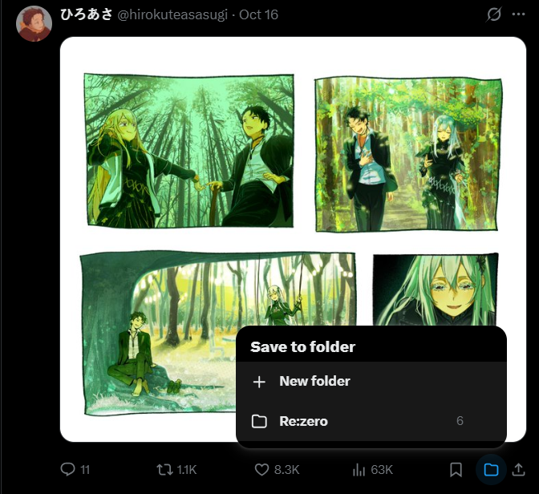
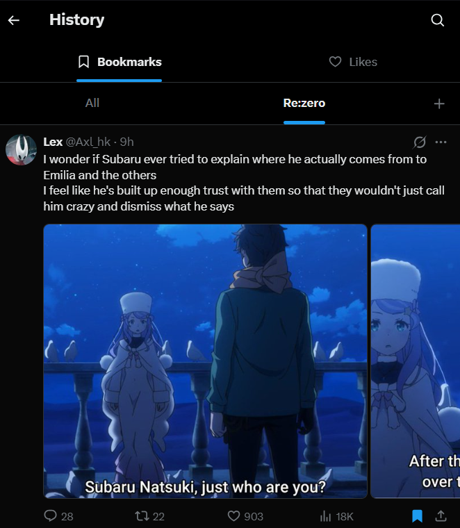
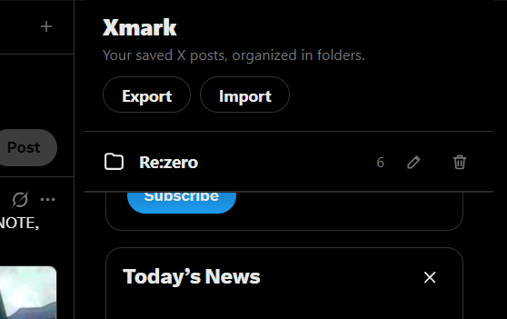

# Xmark

Xmark is a WXT browser extension for organizing X (formerly Twitter) posts. It adds a folder action beside X's native bookmark button, saves sanitized snapshots locally, and lets you browse saved posts on the X Bookmarks page.

## Features

- Create folders from a post or the X Bookmarks page, and toggle posts into or out of folders.
- Browse folder tabs on X's History > Bookmarks view (`/i/history`); the **All** tab leaves X's native bookmarks list unchanged. The older `/i/bookmarks` route is also supported where X still uses it.
- Manage folders and saved posts in the extension popup, including rename, delete, export, and import.
- Store data in the browser with migration from the original Xmark folder format. Export a backup before uninstalling or moving browser profiles.

## How to Use Xmark

### 1. Create a folder and save a post

Click the Xmark folder icon beside a post's native bookmark button. A floating menu will appear, allowing you to create a new folder or add the post to an existing one.

1. Click the folder icon beside the post.
2. Create a folder by entering a name, or select an existing folder.
3. Select the folder to add the post. You can also toggle a post out of a folder it already belongs to.

Each post can belong to multiple Xmark folders.

### 2. Browse your folders on X's Bookmarks page

Navigate to **History → Bookmarks** on X. Your Xmark folders appear as tabs alongside the **All** tab.

- **All** — Displays X's native bookmarks as usual.
- **Folder tabs** — Displays the posts saved in the selected Xmark folder.
- **New folder** — Create a folder directly from the Bookmarks page.

Selecting a folder filters the view to the posts saved in that folder. Your Xmark folders are separate from X's native bookmarks, so a post can be saved in an Xmark folder without being bookmarked on X.

### 3. Manage folders and saved posts

Click the **Xmark toolbar icon** in your browser to open the extension popup.

From the popup, you can:

- View folders and their saved posts.
- Rename or delete folders.
- Remove individual posts from folders.
- Export your folders and saved posts to a backup file.
- Import a previously exported backup.

### 4. Back up your data

Use the popup's **Export** option to download a backup of your folders and saved posts. To restore your data, use **Import** and select a previously exported Xmark backup.

**Important:** Xmark stores its data locally in your browser. Export a backup before uninstalling the extension or moving to another browser profile.

### Notes

- Xmark saves local snapshots of posts for display in your folders. Snapshots may not reflect the latest version of a post.
- Videos and other interactive elements may not function inside saved snapshots. Open the original post on X to access its native functionality.
- Xmark folders are independent of X's native bookmarks and do not automatically bookmark or unbookmark posts on X.

## Run locally

1. Open a terminal in the `xmark` directory and run `npm install` (first run only, or after dependencies change).
2. Run `npm run dev` for Chrome/Chromium or `npm run dev:firefox` for Firefox.
3. Load the generated extension into your browser:
   - **Chrome:** Open `chrome://extensions`, enable **Developer mode**, click **Load unpacked**, and select `.output/chrome-mv3`.
   - **Firefox:** Open `about:debugging#/runtime/this-firefox`, click **Load Temporary Add-on...**, and select `.output/firefox-mv2/manifest.json`.
4. Open X. Use the folder button beside a post's bookmark action to save a post or create a folder. On X's History > Bookmarks view, choose a folder tab to browse its saved posts. Click the Xmark toolbar button to manage folders and backups.

Run `npm run compile` to type-check. For production builds, use `npm run build` (Chrome/Chromium) or `npm run build:firefox` (Firefox). Create a distributable archive with `npm run zip` or `npm run zip:firefox`.

See [CODE_GUIDE.md](./CODE_GUIDE.md) for the architecture, function-by-function overview, and notes on how folder snapshots are displayed on the Bookmarks page.